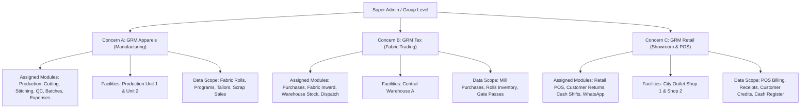
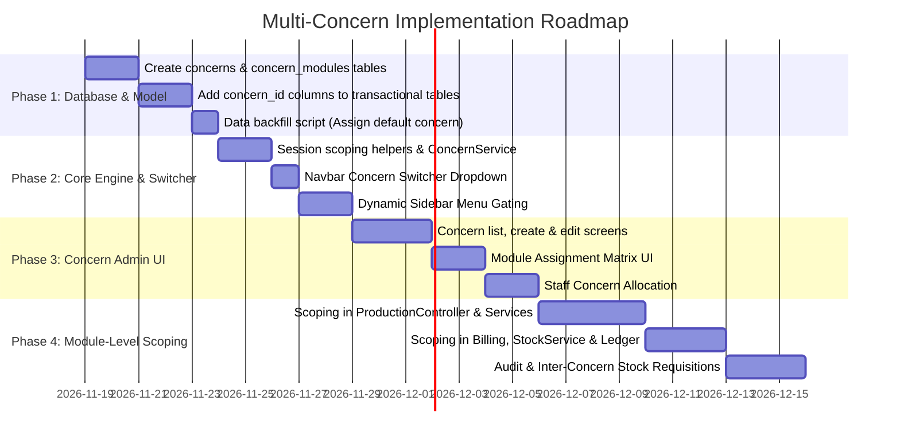

# Multi-Concern Architecture & Concern Creation Module
## Complete Implementation Plan & Architectural Blueprint

---

### Executive Summary

In apparel manufacturing and multi-firm operations, a **"Concern"** represents an independent business entity, legal company, or sister firm (e.g. *GRM Apparels Unit 1*, *GRM Tex Trading*, *GRM Retail & Outlets*). 

This plan details how to transform the GRM platform into a **Multi-Concern Enterprise Platform** where:
1. An administrator can create distinct **Concerns** (with legal name, GSTIN, branding, addresses, invoice prefixes).
2. Modules (Production, Warehouse, Retail POS, WhatsApp, Website, Expenses, Assets) are explicitly **assigned/enabled per Concern**.
3. All operations, stock balances, staff, and transactions are strictly **scoped and partitioned by the active Concern**.
4. Authorized staff can easily switch between Concerns from the top navigation bar without logging out.

---

## 1. System Hierarchy & Data Scoping Model



---

## 2. Database Schema Design (Additive Migrations)

### 2.1 The Master `concerns` Table
Holds the legal identity, taxation profiles, and configuration for each business entity.

```sql
CREATE TABLE `concerns` (
    `id` INT AUTO_INCREMENT PRIMARY KEY,
    `name` VARCHAR(150) NOT NULL COMMENT 'Display Name (e.g. GRM Apparels Unit 1)',
    `code` VARCHAR(50) NOT NULL UNIQUE COMMENT 'Short unique code (e.g. CN-01, GRM-MFG)',
    `legal_name` VARCHAR(255) NULL COMMENT 'Registered Company Name',
    `gst_number` VARCHAR(15) NULL COMMENT '15-digit GSTIN',
    `pan_number` VARCHAR(10) NULL COMMENT '10-digit PAN',
    `address` TEXT NULL,
    `city` VARCHAR(100) NULL,
    `state` VARCHAR(100) NULL,
    `pincode` VARCHAR(10) NULL,
    `phone` VARCHAR(20) NULL,
    `email` VARCHAR(150) NULL,
    `logo_url` VARCHAR(255) NULL COMMENT 'Brand logo printed on invoices/labels',
    `invoice_prefix` VARCHAR(20) DEFAULT 'INV' COMMENT 'Prefix for POS & bills (e.g. GRM-A-)',
    `po_prefix` VARCHAR(20) DEFAULT 'PO' COMMENT 'Prefix for purchases (e.g. PO-A-)',
    `dispatch_prefix` VARCHAR(20) DEFAULT 'DSP' COMMENT 'Prefix for gate passes',
    `is_active` TINYINT(1) DEFAULT 1,
    `created_by` INT NULL,
    `created_at` DATETIME DEFAULT CURRENT_TIMESTAMP,
    `updated_at` DATETIME DEFAULT CURRENT_TIMESTAMP ON UPDATE CURRENT_TIMESTAMP,
    INDEX `idx_concerns_code` (`code`),
    INDEX `idx_concerns_active` (`is_active`)
) ENGINE=InnoDB DEFAULT CHARSET=utf8mb4 COLLATE=utf8mb4_unicode_ci;
```

---

### 2.2 The `concern_modules` Table (Module Entitlement Matrix)
Defines which operational modules are active for a specific Concern.

```sql
CREATE TABLE `concern_modules` (
    `id` INT AUTO_INCREMENT PRIMARY KEY,
    `concern_id` INT NOT NULL,
    `module_key` VARCHAR(50) NOT NULL COMMENT 'e.g. production, warehouse, retail_pos, whatsapp, website, expenses, assets',
    `is_enabled` TINYINT(1) DEFAULT 1,
    `created_at` DATETIME DEFAULT CURRENT_TIMESTAMP,
    UNIQUE KEY `uq_concern_module` (`concern_id`, `module_key`),
    FOREIGN KEY (`concern_id`) REFERENCES `concerns`(`id`) ON DELETE CASCADE
) ENGINE=InnoDB DEFAULT CHARSET=utf8mb4 COLLATE=utf8mb4_unicode_ci;
```

**Standard Module Keys for Assignment:**
- `production`: Fabric Rolls, Planning, Cutting, Stitching, QC, Batch Outward.
- `purchases`: Supplier Sourcing, Purchase Orders, 3rd-Party Mapping.
- `warehouse`: Central Stock, Bin/Rack Storage, Allocations, Inward GRN.
- `retail_pos`: Direct Retail Billing, Thermal Receipts, Cash Drawer.
- `digital_sales`: WhatsApp Orders, Website eCommerce Fulfillment.
- `returns`: RMA Customer Returns & Replacement Exchanges.
- `expenses`: Unit & Operational Expense Vouchers.
- `assets`: Plant Machinery Register & Preventive Maintenance.

---

### 2.3 User to Concern Mapping (`user_concerns`)
Controls staff access to one or multiple concerns.

```sql
CREATE TABLE `user_concerns` (
    `id` INT AUTO_INCREMENT PRIMARY KEY,
    `user_id` INT NOT NULL,
    `concern_id` INT NOT NULL,
    `is_default` TINYINT(1) DEFAULT 0,
    `created_at` DATETIME DEFAULT CURRENT_TIMESTAMP,
    UNIQUE KEY `uq_user_concern` (`user_id`, `concern_id`),
    FOREIGN KEY (`user_id`) REFERENCES `users`(`id`) ON DELETE CASCADE,
    FOREIGN KEY (`concern_id`) REFERENCES `concerns`(`id`) ON DELETE CASCADE
) ENGINE=InnoDB DEFAULT CHARSET=utf8mb4 COLLATE=utf8mb4_unicode_ci;
```

---

### 2.4 Entity Partitioning (Foreign Keys across Master & Transaction Tables)
Every core table receives a `concern_id` column to enforce data segregation:

```sql
-- 1. Facility masters
ALTER TABLE `production_units` ADD COLUMN `concern_id` INT NULL AFTER `id`;
ALTER TABLE `warehouses` ADD COLUMN `concern_id` INT NULL AFTER `id`;
ALTER TABLE `shops` ADD COLUMN `concern_id` INT NULL AFTER `id`;

-- 2. Production & Manufacturing Pipeline
ALTER TABLE `production_purchases` ADD COLUMN `concern_id` INT NULL AFTER `id`;
ALTER TABLE `production_programs` ADD COLUMN `concern_id` INT NULL AFTER `id`;
ALTER TABLE `cutting_batches` ADD COLUMN `concern_id` INT NULL AFTER `id`;
ALTER TABLE `stitching_batches` ADD COLUMN `concern_id` INT NULL AFTER `id`;
ALTER TABLE `label_batches` ADD COLUMN `concern_id` INT NULL AFTER `id`;
ALTER TABLE `qc_batches` ADD COLUMN `concern_id` INT NULL AFTER `id`;
ALTER TABLE `production_batches` ADD COLUMN `concern_id` INT NULL AFTER `id`;
ALTER TABLE `production_outwards` ADD COLUMN `concern_id` INT NULL AFTER `id`;

-- 3. Billing, Sales & Financials
ALTER TABLE `production_bills` ADD COLUMN `concern_id` INT NULL AFTER `id`;
ALTER TABLE `production_returns` ADD COLUMN `concern_id` INT NULL AFTER `id`;
ALTER TABLE `production_expenses` ADD COLUMN `concern_id` INT NULL AFTER `id`;
ALTER TABLE `wastage_sales` ADD COLUMN `concern_id` INT NULL AFTER `id`;
ALTER TABLE `stitching_wastage_sales` ADD COLUMN `concern_id` INT NULL AFTER `id`;

-- 4. Double-Entry Stock Ledger
ALTER TABLE `stock_balances` ADD COLUMN `concern_id` INT NULL AFTER `id`;
ALTER TABLE `stock_transactions` ADD COLUMN `concern_id` INT NULL AFTER `id`;

-- 5. Add Indexes
ALTER TABLE `production_programs` ADD INDEX `idx_prog_concern` (`concern_id`);
ALTER TABLE `production_bills` ADD INDEX `idx_bills_concern` (`concern_id`);
ALTER TABLE `stock_balances` ADD INDEX `idx_stock_concern` (`concern_id`);
```

---

## 3. Scoping Engine & Session Context Implementation

### 3.1 Global Helper Functions (`app/Helpers/Response.php` & `Session.php`)

Add helper primitives to inspect and switch the active concern context:

```php
/**
 * Get current active concern ID from Session.
 */
function currentConcernId(): ?int {
    if (Session::has('active_concern_id')) {
        return (int)Session::get('active_concern_id');
    }
    $u = currentUser();
    if (!empty($u['default_concern_id'])) {
        Session::set('active_concern_id', (int)$u['default_concern_id']);
        return (int)$u['default_concern_id'];
    }
    // Fallback to first available concern
    $first = Database::fetchOne("SELECT id FROM concerns WHERE is_active = 1 ORDER BY id ASC LIMIT 1");
    if ($first) {
        Session::set('active_concern_id', (int)$first['id']);
        return (int)$first['id'];
    }
    return null;
}

/**
 * Get full active concern record.
 */
function currentConcern(): ?array {
    $cid = currentConcernId();
    if (!$cid) return null;
    return Database::fetchOne("SELECT * FROM concerns WHERE id = ?", [$cid]);
}

/**
 * Check if a module is enabled for the current active concern.
 */
function hasConcernModule(string $moduleKey): bool {
    if (isSuperAdmin()) {
        return true; // Super admin sees all, or can toggle mode
    }
    $cid = currentConcernId();
    if (!$cid) return false;
    
    $res = Database::fetchOne(
        "SELECT is_enabled FROM concern_modules WHERE concern_id = ? AND module_key = ?",
        [$cid, $moduleKey]
    );
    return $res ? (bool)$res['is_enabled'] : false;
}
```

---

### 3.2 Top Navbar Concern Switcher (`views/layouts/main.php`)

In the top navbar, display a persistent selector so users can seamlessly switch context:

```html
<!-- Concern Switcher Dropdown in Top Navbar -->
<div class="dropdown me-2">
    <button class="btn btn-sm btn-outline-primary dropdown-toggle d-flex align-items-center gap-2" 
            type="button" data-bs-toggle="dropdown" aria-expanded="false">
        <i class="bi bi-buildings"></i>
        <span class="fw-semibold"><?= e(currentConcern()['name'] ?? 'Select Concern') ?></span>
        <span class="badge bg-primary text-white ms-1"><?= e(currentConcern()['code'] ?? 'ALL') ?></span>
    </button>
    <ul class="dropdown-menu dropdown-menu-end shadow border">
        <li><h6 class="dropdown-header text-uppercase small">Switch Business Concern</h6></li>
        <?php foreach (getAvailableUserConcerns() as $c): ?>
            <li>
                <a class="dropdown-item d-flex justify-content-between align-items-center py-2 <?= (currentConcernId() === $c['id']) ? 'active bg-primary text-white' : '' ?>" 
                   href="<?= url('system/concerns/switch/' . $c['id']) ?>">
                    <span><i class="bi bi-building me-2"></i><?= e($c['name']) ?></span>
                    <span class="badge <?= (currentConcernId() === $c['id']) ? 'bg-light text-primary' : 'bg-secondary' ?>"><?= e($c['code']) ?></span>
                </a>
            </li>
        <?php endforeach; ?>
    </ul>
</div>
```

---

### 3.3 Dynamic Sidebar Filtering Based on Concern Modules

Update `views/layouts/main.php` to respect assigned modules:

```php
<?php
// Only display menu items if the active Concern has that module enabled
$hasProductionModule = hasConcernModule('production') && hasPermission('production', 'view');
$hasWarehouseModule  = hasConcernModule('warehouse') && hasPermission('warehouse', 'view');
$hasRetailPosModule  = hasConcernModule('retail_pos') && hasPermission('production_billing', 'view');
$hasExpenseModule    = hasConcernModule('expenses') && hasPermission('production_expenses', 'view');
?>

<?php if ($hasProductionModule): ?>
    <!-- Production Submenu Items (Cutting, Stitching, QC, Batches) -->
<?php endif; ?>

<?php if ($hasRetailPosModule): ?>
    <!-- Billing and POS Submenu Items -->
<?php endif; ?>
```

---

## 4. Concern Creation & Management UI

### 4.1 Admin Concern Controller (`app/Controllers/ConcernController.php`)
Provides routes for:
1. `GET admin/concerns` &rarr; List all concerns, active status, assigned modules count, staff count.
2. `GET admin/concerns/create` &rarr; Concern registration form.
3. `POST admin/concerns/store` &rarr; Save concern details + initial module assignment checkboxes.
4. `GET admin/concerns/edit/{id}` &rarr; Edit legal details, tax IDs, and logo.
5. `POST admin/concerns/update/{id}` &rarr; Update concern settings.
6. `GET admin/concerns/modules/{id}` &rarr; Checkbox grid for enabling/disabling modules for this concern.
7. `POST admin/concerns/modules/{id}` &rarr; Save enabled module matrix into `concern_modules`.
8. `GET system/concerns/switch/{id}` &rarr; Switches session `active_concern_id` and redirects back.

### 4.2 Module Assignment Interface
When configuring a Concern, admins toggle which capabilities this concern operates:

| Module Name | Module Key | Description | Enable Toggle |
| :--- | :--- | :--- | :--- |
| **Manufacturing & Production** | `production` | Fabric rolls, cutting, stitching, labels, QC, batching | `[X] Enabled` |
| **Purchases & Suppliers** | `purchases` | Fabric sourcing, raw materials, 3rd-party mapping | `[X] Enabled` |
| **Central Warehousing** | `warehouse` | GRN inwards, bin allocations, pack dispatches | `[X] Enabled` |
| **Retail Store & POS** | `retail_pos` | Factory showroom billing, cash drawers, barcoding | `[ ] Disabled` |
| **Digital Order Fulfillment** | `digital_sales` | WhatsApp & Website order packing & shipping | `[ ] Disabled` |
| **Factory Expenses** | `expenses` | Petty cash vouchers, operational unit expenses | `[X] Enabled` |
| **Plant Machinery & Assets**| `assets` | Asset registry, preventive maintenance logs | `[X] Enabled` |

---

## 5. Phased Rollout Roadmap



### Phase 1: Master Schema & Data Migration
- Create additive migration `database/migrations/2026_11_20_add_concern_architecture.sql`.
- Insert a default concern (e.g. *GRM Apparels Head Office - CN01*) so that all existing data automatically maps to Concern ID `1` without downtime or data loss.

### Phase 2: Session Scoping & Context Engine
- Implement `currentConcernId()`, `currentConcern()`, and `hasConcernModule()`.
- Add navbar concern selector and route `system/concerns/switch/{id}`.

### Phase 3: Concern Management Module
- Create `ConcernController.php` and views (`views/admin/concerns/`).
- Provide creation of Concern details (Logo upload, GSTIN, invoice prefix) and the module assignment checklist.

### Phase 4: Controller & Service Query Scoping
- In `ProductionService`, `StockService`, and `ProductionBillingController`, append `WHERE concern_id = currentConcernId()` to queries.
- When creating rolls, batches, bills, or stock transactions, automatically populate `concern_id = currentConcernId()`.

### Phase 5: Reporting & Inter-Concern Transfers
- Update dashboards and reports to support:
  - **Single Concern View**: View P&L, stock, and production metrics for the selected concern.
  - **Consolidated Enterprise View**: Super Admin view showing aggregated figures across all sister concerns.
  - **Inter-Concern Stock Requisitions**: Transfer fabric or garments between Sister Concern A and Sister Concern B with automated transfer invoices.
