# Inventory Software — Module Workflows

This document summarizes the main business workflows represented in the project. It is intended as a high-level guide, not a detailed technical specification.

## End-to-end workflow

**Admin setup → production or supplier stock → warehouse receiving → allocation to shop/channels → sale and dispatch → returns or exchanges → reports, audit, and backup.**

## 1. Admin and master setup

The administrator prepares staff access, business locations, and product information used by the other modules.

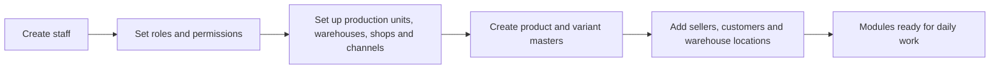

## 2. Production

Fabric and production records are tracked from roll purchase through QC and dispatch.

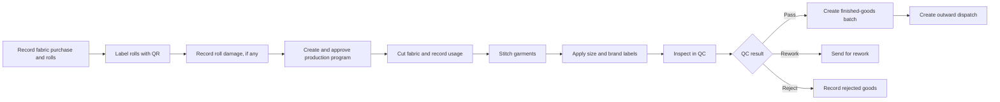

## 3. Purchase mapping and QR generation

After a purchase is recorded, map each purchase line to its catalog category and variant, and set its prices. Saving the mapping creates or updates the catalog variant and creates the GRN; it does not generate QR labels. Generate QR batches manually afterward from the matching Fabric Rolls, Raw Materials, or Third-Party Products area. The variant ID is shown in the generator as a reference, while the existing QR label code logic remains unchanged. Stock is posted separately from the generated batch; fabric still requires QC first.

The Return QR area is currently a disabled preview and does not generate labels.

## 4. Warehouse receiving and stock

The warehouse receives finished production, supplier goods, and returned goods, then verifies and stores them.

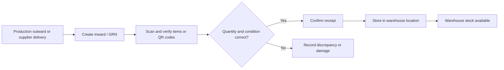

## 5. Warehouse allocation and dispatch

Stock is reserved and sent to a shop or sales channel after a request is processed.

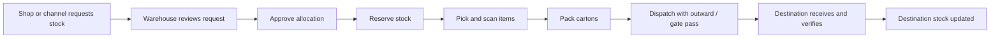

## 6. Retail shop and POS

The shop receives stock, sells it at POS, and records the sale and payment.

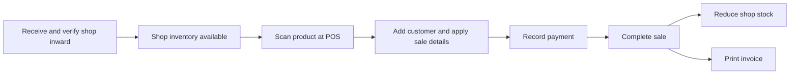

## 7. WhatsApp sales channel

Staff record WhatsApp orders and process them using the channel's available stock.

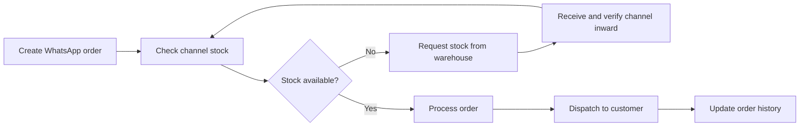

## 8. Website sales channel

Website orders follow a similar stock and fulfillment workflow, using website-channel inventory.

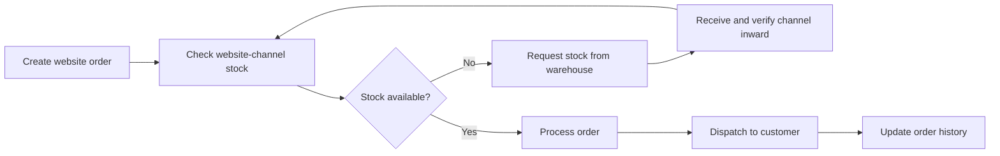

## 9. Returns and exchanges

Returns are looked up against the original sale or order. The returned item is inspected before stock and refund actions are recorded.

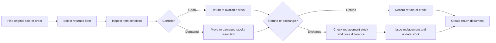

## 10. Cash and expenses

The shop cash module tracks drawer shifts and transactions. Expenses are also recorded for operational areas and channels.

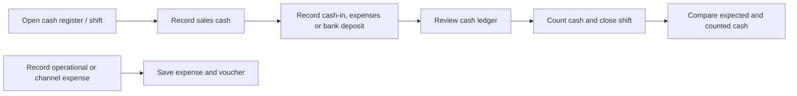

## 11. Assets and maintenance

Equipment is registered and tracked through maintenance and transfers.

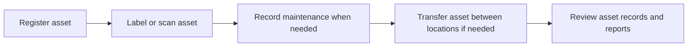

## 12. Reports, settings, audit, and backup

Managers review operational results; administrators manage system configuration and data protection.

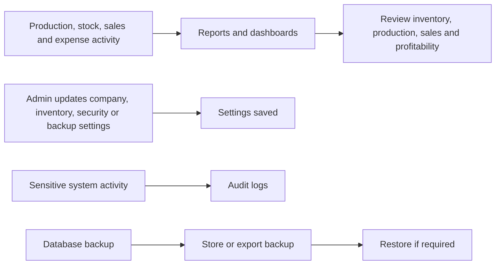

## Invoice example note

The supplied sample invoice shows ₹10,500 as the taxable amount and ₹525 as tax, while the displayed grand total remains ₹10,500. If tax is added on top, the total would be ₹11,025. Confirm whether the sample is intended to show tax-inclusive pricing or needs a corrected total.
