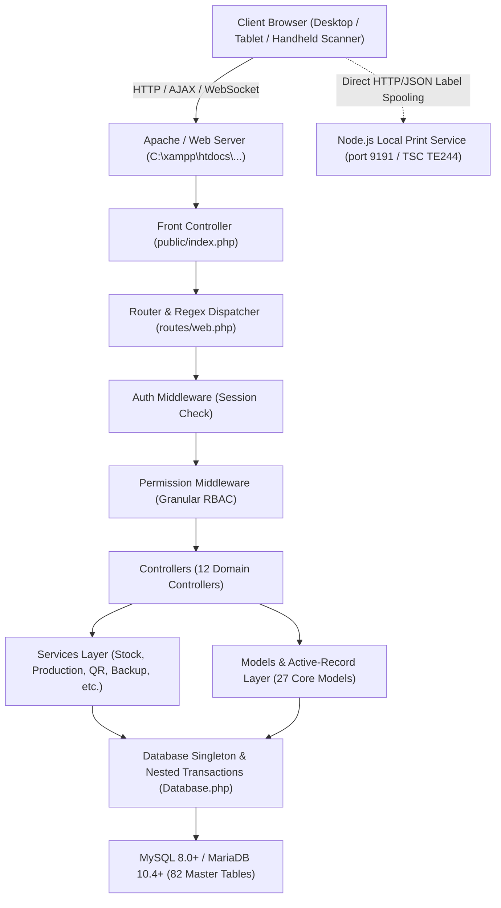
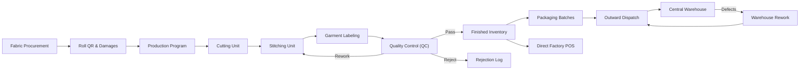
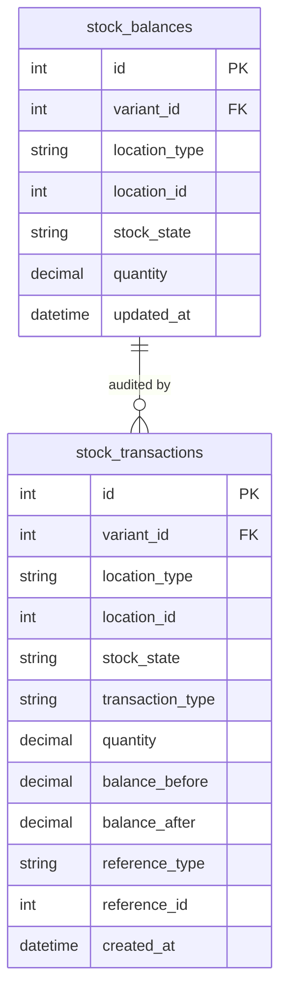

# GRM Inventory & Production Management System
## Comprehensive End-to-End Codebase Analysis & Technical Audit

---

### Executive Overview

The **GRM Inventory & Production Management System** is an enterprise-grade manufacturing, central warehousing, and multi-channel inventory platform engineered specifically for the apparel industry. The software governs the entire lifecycle of textile manufacturing: from raw fabric roll procurement and roll-level QR tracking, through production programming, fabric cutting, tailor stitching, garment labeling, piece-level quality control (QC), packaging, production billing (POS), outward dispatch to central hubs, inter-module stock requisitions, and warehouse rework handling.

---

## 1. System Architecture & Technology Stack



### Technology Matrix
- **Core Engine**: PHP 8.0+ / 8.1+ running with strict types where configured, leveraging a custom lightweight MVC architecture.
- **Data Persistence**: MySQL 8.0+ / MariaDB 10.4+ utilizing PHP PDO with full transaction nesting, strict parameter binding, and timezone alignment (`+05:30` Asia/Kolkata).
- **Presentation Layer**: Responsive PHP server-rendered views with Bootstrap 5.3.3, Bootstrap Icons 1.11.3, and custom modular style sheets.
- **Hardware & Peripherals**:
  - Direct ESC/POS and TSPL thermal printing via a local Node.js socket server (`printer_service/server.js`) on port 9191.
  - Interactive barcode/QR scanning using `html5-qrcode` and `qrcode.min.js`.
- **Cloud & Auxiliary Services**:
  - Cloudinary REST API (`CloudinaryService.php`) for off-server media storage.
  - SMTP / PHPMailer (`MailService.php`) for encrypted automated database backups and notification delivery.

---

## 2. Directory Structure & Code Organization

```text
inventory_management-1/
├── app/
│   ├── Controllers/             # 12 Web & API Controllers
│   │   ├── AdminController.php                  # Staff, roles, production units
│   │   ├── AssetController.php                  # Machine & plant assets, maintenance
│   │   ├── AuthController.php                   # Authentication, session, password reset
│   │   ├── InwardController.php                 # Purchase goods inward (GRN)
│   │   ├── ProductionBillingController.php      # Production POS, direct invoicing & dispatches
│   │   ├── ProductionController.php             # Core manufacturing & master catalog engine
│   │   ├── ProductionReturnController.php       # Customer returns & exchange RMA handling
│   │   ├── ProductionStockRequestController.php # Inter-unit stock requisitions
│   │   ├── QrGenerationController.php           # Batch QR generation (Manual & Catalog)
│   │   ├── StockAdjustmentController.php        # QR-driven stock reconciliation
│   │   ├── SystemController.php                 # Audit logs, system settings, backups
│   │   └── VariantController.php                # Product variant SKU & label management
│   ├── Helpers/                 # Core Framework Primitives
│   │   ├── Auth.php                             # Authenticated session user accessor
│   │   ├── CSRF.php                             # Cryptographic CSRF token generation & validation
│   │   ├── Database.php                         # PDO singleton with nested transaction support
│   │   ├── Request.php                          # HTTP request parsing and sanitization
│   │   ├── Response.php                         # View rendering, JSON responses, global helpers
│   │   ├── Session.php                          # Secure session management & flash messages
│   │   └── Validator.php                        # Form input validation rules engine
│   ├── Middleware/              # Request Interceptors
│   │   ├── AuthMiddleware.php                   # Redirects unauthenticated requests to login
│   │   └── PermissionMiddleware.php             # Enforces module/action access controls
│   ├── Models/                  # 27 Active Data Models
│   │   ├── Asset.php, AssetCategory.php, AssetMaintenance.php
│   │   ├── CuttingBatch.php, CuttingItem.php, Design.php
│   │   ├── LabelBatch.php, LabelItem.php, ProductVariant.php
│   │   ├── ProductionBatch.php, ProductionBatchItem.php
│   │   ├── ProductionProgram.php, ProductionProgramItem.php
│   │   ├── ProductionUnit.php, ProductionWarehouseRework.php
│   │   ├── PurchaseInward.php, PurchaseItem.php
│   │   ├── QCBatch.php, QCItem.php, Role.php, User.php
│   │   ├── StitchingBatch.php, StitchingItem.php
│   │   └── StockAdjustment.php, StockBalance.php, StockTransaction.php
│   └── Services/                # Core Business Logic Layer
│       ├── AuditService.php                     # Immutable logging of sensitive actions
│       ├── BackupService.php                    # SQL/ZIP dumps, automated cleanup, encryption
│       ├── CloudinaryService.php                # Cloud media asset management
│       ├── MailService.php                      # Direct SMTP mailer
│       ├── ProductionReportService.php          # Manufacturing yield, wastage & scrap analytics
│       ├── ProductionService.php                # Factory lifecycle orchestrator
│       ├── QrFinderService.php                  # Universal QR status and provenance search
│       ├── QrGenerationService.php              # Bulk barcode & QR generation engine
│       ├── SettingsService.php                  # Dynamic system configurations
│       ├── StockService.php                     # Double-entry ledger & location balances
│       └── VariantService.php                   # SKU generation & variant resolution
├── config/                      # app.php, database.php, cloudinary.php
├── cron/                        # backup.php (Scheduled automated backups)
├── database/                    # schema.sql (82 tables), seed.sql, migrations/
├── printer_service/             # Local Node.js Windows service for TSC TE244 thermal printer
├── public/                      # Front controller (index.php), static CSS/JS, fonts
├── routes/                      # web.php (Central routing table with regex parameters)
└── views/                       # Production, admin, asset, system, layout & partial templates
```

---

## 3. End-to-End Manufacturing & Business Workflows

The system models a strict multi-tier production workflow where each stage produces verifiable inputs for subsequent stations:



### Module 1: Fabric Roll Procurement & Damage Handling
- **Procurement**: Fabric mills and suppliers (`sellers`) supply raw fabric rolls (`seller_rolls`).
- **QR Coding**: Every roll receives a unique alphanumeric tracking code (e.g., `ROL-202611-0001`) encoding roll length, shade, fabric type, and weight.
- **Damage Inspection**: Damaged or stained fabric is recorded in `roll_damages` with specific reason codes. Defective rolls can be returned, replaced, or written off before issuance to production.

### Module 2: Unified Purchases & Third-Party Product Mapping
- Unified purchase management (`production_purchases`, `production_purchase_items`) supports:
  1. *Fabric Rolls* for production.
  2. *Third-Party Products* bought finished from external vendors.
  3. *Supplies & Accessories* (zippers, threads, buttons, packaging).
- **Mapping Module**: Allows third-party vendor SKUs to be mapped directly to internal catalog variants, generating internal tracking barcodes.

### Module 3: Production Programs & Approvals
- **Planning**: A production program (`production_programs`, `production_program_items`) specifies the target garment design, expected pieces across size/color matrices, and fabric roll allocation.
- **Authorization Gate**: Programs cannot proceed to cutting until an authorized manager executes `approveProgram()`, preventing unauthorized fabric consumption.

### Module 4: Cutting Unit & Fabric Scrap Selling
- **Execution**: Rolls are marked as consumed (`cutting_batch_rolls`), and actual cut panels are logged by size in `cutting_items`.
- **Wastage Ledger**: Fabric offcuts and end-bits are weighed and recorded. The scrap is monetized through **Fabric Wastage Sales** (`wastage_sales`), issuing numbered receipts.

### Module 5: Stitching Unit & Assembly Lines
- **Assignment**: Cut bundles are transferred to stitching batches (`stitching_batches`) and assigned to specific tailors or contractor assembly lines.
- **Wastage Ledger**: Defective panels and thread remnants are logged and sold via **Stitching Wastage Sales** (`stitching_wastage_sales`).

### Module 6: Garment Labeling & Piece-Level Tracking
- **Batching**: Stitched garments enter `label_batches`.
- **Serialization**: Size and brand labels are sewn in. The system assigns a unique piece tag code (`tag_code`) to every single physical garment, enabling piece-level traceability.

### Module 7: Quality Control (QC) & Inspection
- **Inspection**: QC inspectors examine each garment against tolerance standards (`qc_batches`, `qc_items`).
- **Disposition**:
  - **PASS**: The piece tag is marked as approved and immediately enters Available Finished Goods Inventory.
  - **REWORK**: Tagged with defect notes and routed back to tailor stations.
  - **REJECT**: Recorded as unsellable scrap.

### Module 8: Finished Goods Inventory & Production Billing (POS)
- **Inventory Engine**: QC-passed garments are tracked in real-time.
- **Direct Billing**: Garments can be sold directly from the production facility via **Production Billing** (`production_bills`, `production_bill_items`):
  - Integrates barcode/QR lookup.
  - Handles customer details, payment methods (Cash, Card, UPI, Credit), GST/HSN tax calculation, and discounts.
  - Generates thermal POS slips or A4 tax invoices.
  - Immediately reduces finished goods balance in `stock_balances` and records audit rows in `stock_transactions`.

### Module 9: Customer Returns & Exchanges (RMA)
- Handled through `ProductionReturnController`:
  - Scans or looks up original bill number.
  - Evaluates returned garment condition (Restockable vs Damaged).
  - Processes settlement via Cash Refund, Store Credit, or immediate Product Exchange with price-differential recalculation.

### Module 10: Packing Batches & Warehouse Outward Dispatch
- **Carton Packing**: QC-passed inventory is packed into shipping cartons or batches (`production_batches`).
- **Outward Dispatch**: Batches are assigned to an outward gate pass (`production_outwards`) specifying destination warehouse, vehicle number, driver details, and dispatch timestamps.
- **Arrival Verification**: The receiving warehouse scans the master batch QR to verify and confirm receipt into central warehouse inventory.

### Module 11: Warehouse Rework Pipeline
- If the central warehouse discovers stitching defects or transport damage, goods are returned via `production_warehouse_reworks`.
- Production units receive the rework batch, re-assign tailors, execute corrections, re-inspect through QC, and re-dispatch back to the warehouse with updated tracking.

### Module 12: Inter-Module Stock Requisitions
- Facilities (production units, retail shops, warehouses) can issue stock requisition requests (`production_stock_requests`).
- Tracks four-phase state progression: `Requested` &rarr; `Approved / Allocated` &rarr; `Dispatched / In-Transit` &rarr; `Received & Verified`.

### Module 13: Fixed Asset Register & Machine Maintenance
- **Registry**: Tracks all plant machinery (cutting machines, Juki sewing machines, overlock machines, generators) in `assets`.
- **Maintenance**: Logs breakdown repairs, preventive servicing schedules, technician costs, and downtime in `asset_maintenance_logs`.
- **Transfers**: Records asset movement between factory units.

### Module 14: Factory Expense Management
- Records operational expenses across factory units (`production_expenses`) categorized by rent, utilities, fuel, maintenance, tea/snacks, and petty cash.
- Provides expense voucher generation and monthly unit-wise expenditure summaries.

---

## 4. Data Layer & Double-Entry Stock Ledger

### The Immutable Stock Ledger (`StockService.php`)

To prevent inventory drifting and discrepancies, all physical goods are governed by a double-entry ledger:



1. **`stock_balances`**: Maintains the current balance for every distinct combination of:
   - `variant_id`: Specific product color/size SKU.
   - `location_type`: `'PRODUCTION'`, `'WAREHOUSE'`, or `'SHOP'`.
   - `location_id`: The specific physical facility ID.
   - `stock_state`: `'AVAILABLE'`, `'RESERVED'`, `'DAMAGED'`, or `'IN_TRANSIT'`.
2. **`stock_transactions`**: Every state modification (`increase`, `decrease`, `reserve`, `release`, `transfer`, `adjust`) writes an immutable record capturing `balance_before`, delta `quantity`, `balance_after`, `reference_type` (e.g. `BILL`, `OUTWARD`, `INWARD`), and the acting user ID.
3. **Database Concurrency**: Updates use `FOR UPDATE` row locks inside explicit database transactions to prevent race conditions during high-speed POS scanning.

---

## 5. Security, RBAC & Governance

### 1. Role-Based Access Control (RBAC)
- Roles (`roles`) define baseline module and action permissions.
- Permissions (`permissions`) follow a strict `module.action` convention (e.g. `cutting.create`, `qc.edit`, `billing.view`, `audit.purge`).
- Granular User Overrides (`user_permission_overrides`): Super Admins can grant or revoke specific granular capabilities on individual users regardless of their base role.

### 2. Defense in Depth
- **Zero Raw SQL Injection**: All queries utilize PDO prepared statements with positional or named parameter binding.
- **CSRF Defense**: Non-idempotent HTTP methods (`POST`) validate a cryptographically secure token (`CSRF::validateToken()`).
- **XSS Prevention**: All view renders sanitize HTML output using `e()` (`htmlspecialchars`).
- **Audit Logging**: Sensitive actions (role reassignments, price overrides, stock deletions, expense approvals) automatically generate an unalterable log in `audit_logs` containing IP address, user agent, and before/after JSON states.

---

## 6. Hardware Integration: TSC TE244 Thermal Printer Service

The repository includes a dedicated background printing service (`printer_service/`):

- **Architecture**: A lightweight Node.js daemon listening on `127.0.0.1:9191`.
- **Purpose**: Bypasses the standard browser print preview dialog, providing sub-second barcode label printing directly to Windows thermal printer spoolers.
- **Protocol**: Converts incoming JSON payload into native **TSPL (TSC Printer Language)** command streams:
  ```text
  SIZE 40 mm, 22 mm
  GAP 2 mm, 0 mm
  DIRECTION 1
  CLS
  TEXT 10,10,"2",0,1,1,"GRM APPAREL"
  BARCODE 10,40,"128",40,1,0,2,2,"ROL-202611-0001"
  PRINT 1,1
  ```
- **Dual-Up Support**: Automatically splits label jobs across 2-column label rolls to prevent media wastage.

---

## 7. Key Findings, Strengths & Technical Recommendations

### Key Architectural Strengths
1. **End-to-End Traceability**: The ability to trace a finished garment sold at POS back through QC, stitching, cutting, and to the original supplier fabric roll is exceptionally well-engineered.
2. **Atomic Stock Ledger**: The double-entry ledger design guarantees mathematical consistency across multi-location transfers.
3. **Hardware Agnostic**: Includes browser printing fallbacks while providing high-speed raw TSPL streaming for industrial thermal printers.

### Technical Recommendations & Roadmap
1. **Controller Refactoring**: `ProductionController.php` is currently ~928 KB in a single file. While fully functional, modularizing it into domain-specific sub-controllers (e.g., `FabricController`, `CuttingController`, `QcController`, `CatalogController`) will improve code navigability and team concurrency.
2. **Database Index Optimization**: Ensure composite indexes on `(variant_id, location_type, location_id, stock_state)` in `stock_balances` and `(roll_code)` in `seller_rolls` are maintained for high-volume deployments.
3. **Automated Migration Runner**: The custom `database/run_all_migrations.php` is robust for local XAMPP environments; wrapping it into a standard CLI command (`php agy migrate`) will further streamline remote server deployments.
